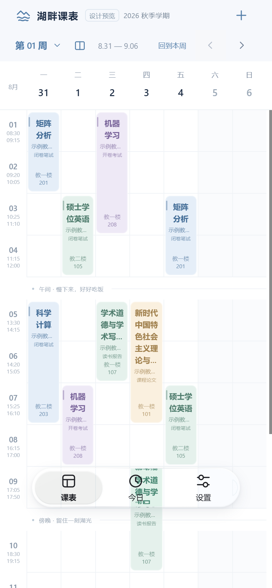
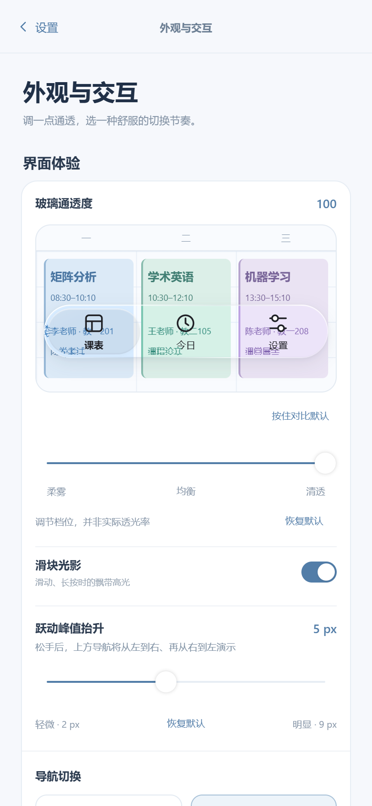
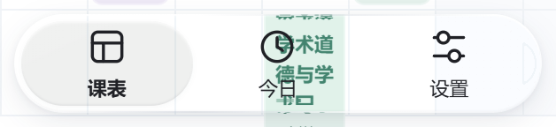
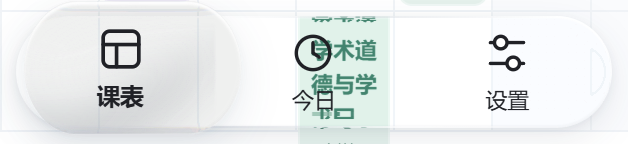
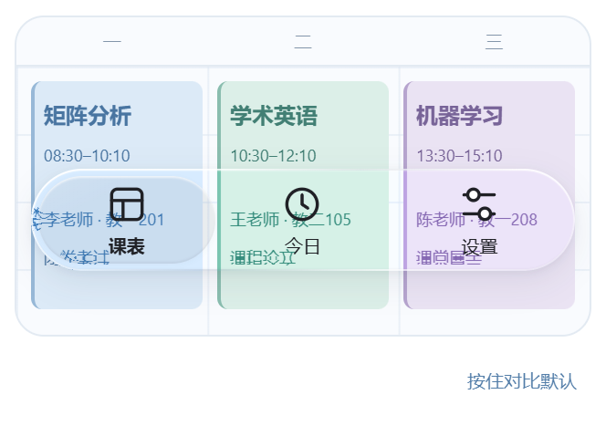
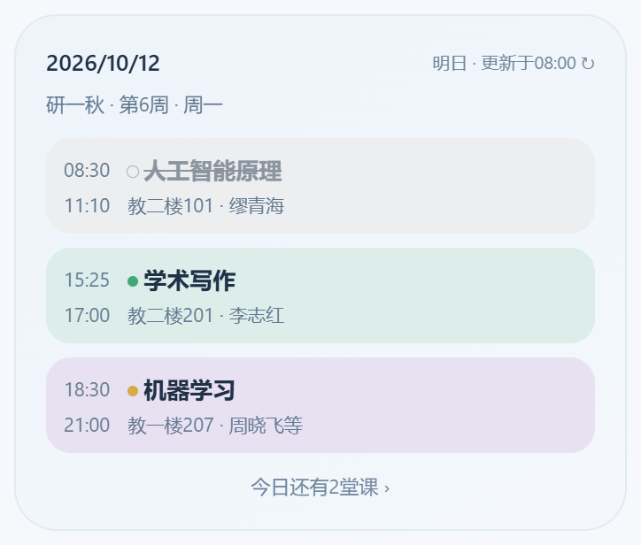
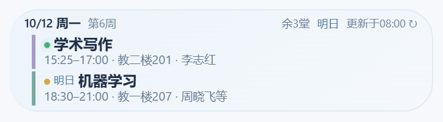
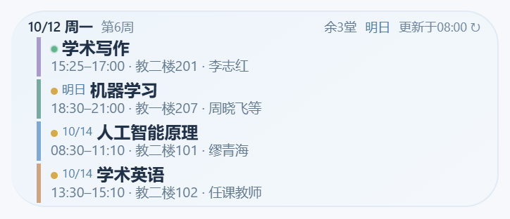
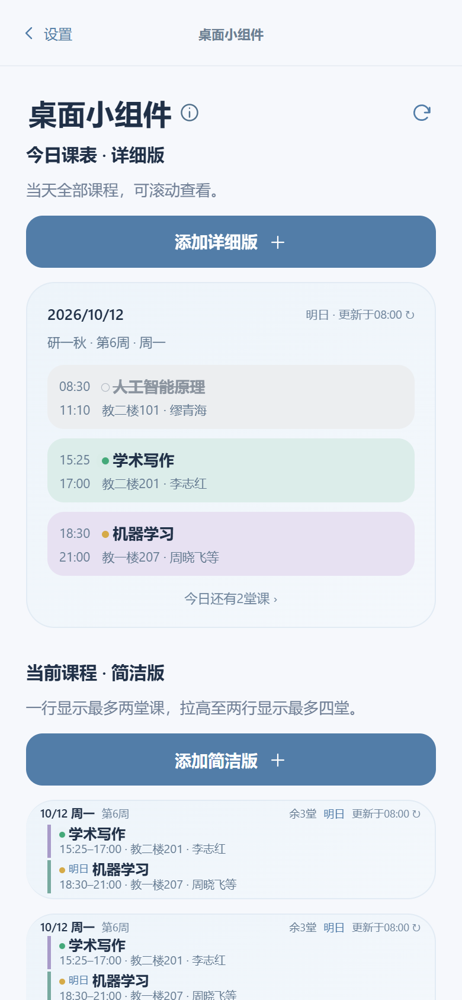

# 湖畔课表

面向中国科学院大学研究生的非官方课表应用，基于 uni-app、Vue 3 和 TypeScript 开发。支持教务课表导入、离线查看、今日课程、液态玻璃导航和 Android 桌面小组件。

目前仅适配 Android 手机，暂未适配 iOS。H5 用于界面预览，不接入学校登录与原生小组件。项目未使用 uniCloud。

## 界面预览

以课表为主界面，让玻璃导航悬浮在课程内容之上。通透度与交互效果可在设置中直接预览。

<p align="center">
  
  
</p>

以上为最新源码的 H5 界面截图，使用示例课表；不同设备的字体、滤镜支持及屏幕尺寸可能影响最终呈现。

## 液态玻璃

底部导航采用圆润的悬浮胶囊，透出背后的课程色块，并叠加边缘折射、高光与阴影。选中滑块在切换时发生位移和形变，支持“跃动”和“流动”；按压、拖动时的飘带高光随交互变化。

| 静止状态 | 按压状态 |
| --- | --- |
|  |  |

玻璃通透度可在 0–100 之间调节，默认 100；这是材质调节档位，并非实际透光率。下图展示玻璃覆盖彩色课程时的效果，文字与图标保持独立的清晰前景层。

<p align="center">
  
</p>

材质实现使用 WebView、CSS 与 SVG 位移滤镜，部分折射计算改编自 AndroidLiquidGlass。实现说明见 [液态玻璃导航](docs/liquid-glass-navigation.md)，来源与许可见文末。

## 桌面小组件预览

两种组件适合不同的查看方式：详细版展示当天课表，简洁版突出当前和接下来的课程。彩色课程区域、起止时间、地点、教师与状态灯帮助快速判断上课安排。

| 今日课表 · 详细版 | 当前课程 · 简洁版 |
| --- | --- |
|  | <br /><br /> |

这些图片截取自 App 设置页中的样式示意，**不是 Android 桌面真机截图**。真实桌面组件由 Kotlin / RemoteViews 渲染，尺寸与可见内容随桌面和组件高度调整。简洁版的一行、两行指桌面占格高度。

<details>
  <summary>查看 App 内的小组件管理页面</summary>
  <p align="center">
    
  </p>
</details>

## 功能

- **周课表**：教学周选择、手势切周、课程起止时间、多组上课安排及冲突展示。
- **今日课程**：显示当天课程与下一节课，今日上完后不提前显示明天的课程。
- **课程详情**：查看周次、节次、地点、教师和考试信息，编辑并保存课程信息。
- **教务导入**：在 App 内登录 SEP，读取选修课程、个人课表和课程详情，核对学期设置后保存。
- **读取动画**：读取期间持续显示高斯模糊背景与清晰的点阵动画，完成后显示对勾。
- **外观与交互**：液态玻璃导航、通透度调整、导航动效及减少动画选项。
- **桌面小组件**：Android 今日课表与当前/下一节课程，使用本地课表快照，可离线显示。
- **开发预览**：测试栏目和预览实验室仅在开发模式显示，正式构建隐藏入口。

首次启动使用示例课表。真实课表确认保存后存储在当前设备，关闭应用或断网后仍可查看。

## 开发环境

- Node.js 22 与 npm。
- HBuilderX 5.26 或与项目编译器兼容的版本，用于 App 真机运行与原生打包。
- Android 手机或模拟器；应用配置的最低版本为 Android 6.0（API 23）。
- 可选编辑器：VS Code，推荐 Vue - Official 扩展。

当前 DCloud 核心依赖固定为 `3.0.0-5020620260917001`，Vue 为 `3.4.21`，Vite 为 `5.2.8`。请保留 `package-lock.json` 并使用 `npm ci` 安装依赖。

## 本地运行

在项目根目录执行：

```sh
npm ci
npm run dev:h5
```

打开 <http://127.0.0.1:5173>。桌面端显示手机预览框，也可使用浏览器移动设备模式检查布局。

`npm run dev` 使用 <http://127.0.0.1:8080>。两者都是 uni-app 的 H5 开发服务，不能用 Live Server 或直接打开 `index.html` 替代。

| 命令 | 用途 |
| --- | --- |
| `npm run dev:h5` | H5 开发预览，端口 5173 |
| `npm run dev:app` | 持续编译 App 调试资源 |
| `npm run typecheck` | Vue / TypeScript 类型检查 |
| `npm test` | Vitest 自动化测试 |
| `npm run build:h5` | 构建 H5，输出到 `dist/build/h5` |
| `npm run build:app` | 构建 App 资源，输出到 `dist/build/app` |

`dev:app-plus`、`build:app-plus` 是对应 App 命令的兼容别名。`build:app` 会先运行小组件状态灯资源生成脚本。

## Android 运行与打包

1. 在 HBuilderX 中打开整个项目根目录，即包含 `package.json` 的目录，并执行 `npm ci`。
2. 检查 `src/manifest.json` 中的 DCloud AppID、版本及发行配置，使用自己的账号与签名设置。
3. 手机开启 USB 调试，连接电脑后选择“运行到手机或模拟器”。编译器与运行基座应保持兼容。
4. 调试 Android 小组件时，需要包含 `lakeside-widget` UTS 插件的自定义基座。更新 Kotlin、Manifest 或原生资源后，应重新构建原生基座或 APK。
5. 发布时在主工程选择“发行 → 原生 App → 云打包”，选择 Android 正式包并配置签名。当前项目发布流程使用快速安心打包，详细步骤见 [Android 正式包说明](docs/android-widget-release.md)。

`npm run build:app` 生成的是应用资源，**不是可安装的 APK**。不要将 `src` 或 `dist/build/app` 作为新的主工程维护。最终 APK 必须包含小组件的原生类、Provider 和布局；仅前端热更新不能加入这些内容。

应用图标和开屏资源分别保存在 `unpackage/res/icons`、`unpackage/res/splash`。

## 教务导入

在 Android App 的课表页点击右上角加号，进入 SEP 登录，在教务中打开“选修课程”或“个人课表”，然后点击“读取当前课表”。读取完成后核对课程及第一教学周周一、教学周数、校区，再确认保存。

当前代码支持两组教务域名：

| 页面 | 支持的来源 |
| --- | --- |
| SEP 登录与门户 | `https://sep.ucas.ac.cn` |
| 选课系统 | `https://xkgodj.ucas.ac.cn`、`https://xkgo.ucas.ac.cn:3000` |
| 课程详情 | `https://jwxk.ucas.ac.cn`、`https://xkcts.ucas.ac.cn:8443` |

选课系统支持 `/courseManage/main`、`/courseManage/selectedCourse` 和 `/course/personSchedule` 等现有路由。导入在当前登录会话中进行，缺失信息与失败课程会在结果预览中列出；确认保存前不会覆盖原有课表。

导入解析器不提取密码或 Cookie，也不将它们写入课表数据。课表与小组件快照保存在本机。学校登录本身需要联网，教务网页结构变化时可能需要更新解析逻辑。反馈问题时请删除日志中的账号、票据、token 和个人课程信息。

## Android 桌面小组件

小组件源码位于 `src/uni_modules/lakeside-widget`，使用 Kotlin、UTS、RemoteViews 和 WorkManager。保存课表后同步本地快照，支持桌面添加、手动刷新及进入课表。

周期刷新受系统省电策略影响，不保证上下课准点更新；一键添加是否可用取决于桌面支持，也可从系统小组件列表手动添加。

- [小组件架构、功能与调试](docs/android-widgets.md)
- [正式 APK 打包与检查](docs/android-widget-release.md)

部分原生验证脚本需要 PowerShell、JDK、Android SDK 或 HBuilderX。脚本中的本机工具路径需要按自己的环境调整。

## 项目结构

```text
src/
  pages/                         页面入口
  components/                    课表、今日、设置、导航与导入界面
  domain/                        课表计算、小组件模型及材质参数
  stores/                        Pinia 状态与本地课表保存
  services/                      原生小组件接入与同步
  import/                        UCAS 地址识别、页面提取与导入会话
  static/                        图标、开屏图、读取浮层与第三方许可
  styles/                        公共样式
  uni_modules/lakeside-widget/    Android UTS / Kotlin 插件及资源
  manifest.json                  App 配置
  pages.json                     页面配置
scripts/                         构建辅助、资源生成与验证脚本
tests/                           TypeScript 与原生模型测试
docs/                            实现说明、排查记录与预览图
design/                          设计源素材
unpackage/res/                   打包配置引用的图标与开屏资源
```

`docs` 中部分文件保留了早期实现与本机排查记录；当前行为以源码为准。常用说明包括 [液态玻璃导航](docs/liquid-glass-navigation.md)、[读取模糊](docs/nav-return-flow-reading-blur.md) 和 [正式包资源裁剪](docs/APK_SIZE_FILTER.md)。

## 来源与许可

液态玻璃的部分折射计算参考并改编自 Kyant0 的 [AndroidLiquidGlass](https://github.com/Kyant0/AndroidLiquidGlass)，本项目将相关计算适配到 WebView / SVG。原始 Apache-2.0 许可和修改声明分别保存在 [LICENSE](src/static/licenses/AndroidLiquidGlass-LICENSE.txt) 与 [NOTICE](src/static/licenses/AndroidLiquidGlass-NOTICE.txt)。

本项目是独立开发的非官方应用，与中国科学院大学及其教务系统无隶属关系。第三方代码和品牌素材遵循各自的授权范围；仓库目前未声明项目整体的开源许可证。
